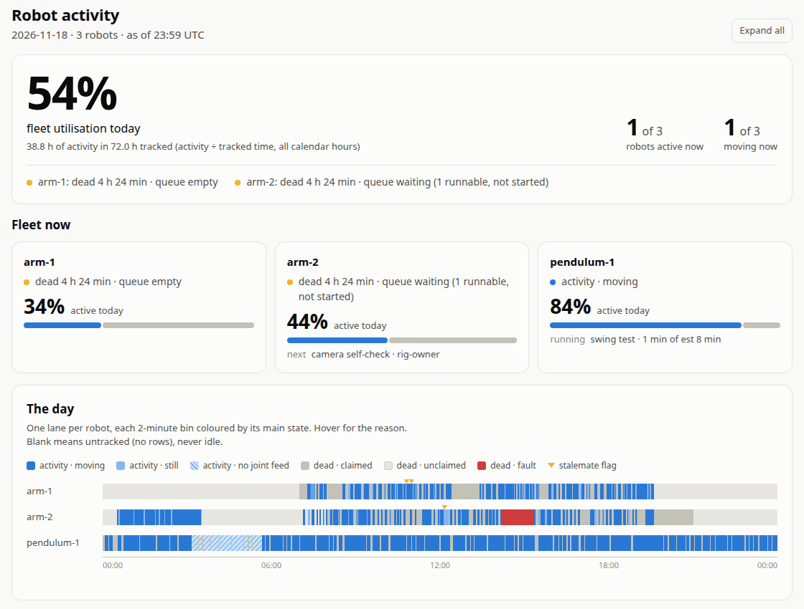

# Robot Activity Agent

[](https://github.com/zacharyyamaoka/robot_activity/actions/workflows/test.yml)
[](LICENSE)

**Keep every robot doing useful work, and say why when it isn't.**

**Landing page, with the dashboard replaying a demo fleet's day:** [zacharyyamaoka.github.io/robot_activity](https://zacharyyamaoka.github.io/robot_activity/) · [the demo dashboard](https://zacharyyamaoka.github.io/robot_activity/dashboard.html) · [changelog](CHANGELOG.md)

A robot that could be working and isn't is wasted capital, the way an idle press is in a plastics plant. This package
is a drop-in member of a robotics team with exactly that remit. It measures activity per robot and per fleet, keeps a
work queue full and moving, flags stalemates, and runs an agent loop that prompts the right people. It never decides
*what* the work is: queue items belong to their owners.



Runtime dependencies: [robot-msgs](https://pypi.org/project/robot-msgs/) and the standard library. `wandb` is an extra.

## The three splits

Every tracked second of every robot falls on exactly one side of each split:

| split | sides | rule |
|---|---|---|
| claim | claimed / unclaimed | someone (`claimed_by`) holds the robot |
| activity | activity / dead | claimed **and** a queue item is dispatched **and** health is `ok`. Being still inside a running item is activity. |
| motion | moving / still / unknown | from the joints. **Unknown** (no joint feed) is never counted as idle. |

Tracked time is the sum of the rows' `sample_s`. A gap with no rows (the sampler was down) is untracked, never idle.
Utilisation is activity ÷ tracked. Every dead or still second gets a reason: an explicit one, a fault, "queue waiting
(2 runnable, not started)", "blocked on code: IK refuses the bin pose", "queue empty", "claimed, nothing dispatched" or
"unclaimed".

## 30-second quickstart

```bash
pip install "robot-activity @ git+https://github.com/zacharyyamaoka/robot_activity"
```

```bash
robot-activity demo --root fleet
```

```bash
robot-activity summary --root fleet
```

```bash
robot-activity queue --root fleet
```

```bash
robot-activity agent tick --root fleet --config examples/agent.toml
```

```bash
robot-activity dashboard --root fleet --out activity.html
```

`demo` simulates today for three robots: two arms and a 1-DOF pendulum, their owners, a work queue and the real agent
ticking every minute. The simulated owners react to the agent's prompts. The day includes a looping regrasp, a frozen
run, a bus fault, items blocked on code, data, a human and hardware, and a joint feed that drops out. `summary` prints
the day on the three splits (`--json` for one document). `queue` shows the active queue on one screen. `agent tick`
runs one pass of the agent's loop. `dashboard` writes one self-contained HTML file: light and dark, phone-width safe,
no network.

## The queue

The queue is files a human can read: one JSON file per item, an append-only events ledger and an `fcntl` lock.
Everything goes through one writer API: the `Queue` class, or the CLI for programs that never import this package.

- **Owners.** Every item has an `owner`, who decides what it is, and an `executor`, who starts it (defaults to the
  owner). The agent never starts, finishes, blocks or edits anyone's item.
- **Ready means the code is shared.** An item is ready only when its owner has attached a `PolicyRef`, the code it will
  run (`repo@commit:path::entrypoint`). Nothing may block it, and its dependencies must have finished ok. When something
  looks wrong, whoever sees it can open that exact code and judge whether the behaviour is expected. A not-ready item
  always says why: `code`, `dependency`, `human`, `hardware`, `data` or `other`, with the owner's ETA when known.
- **Priority.** A deployed system's own work runs first (`system`, 0), then agent work (`agent`, 5), then the program's
  declared fillers (`filler`, 9). Within a priority, first submitted runs first. One item runs per robot.

```bash
robot-activity queue submit --root fleet --title "pick vial" --owner pnp-agent --est-min 6 --robot arm-1 --policy-repo https://github.com/you/policies --policy-commit 0123abcd --policy-path policies/pick.py
```

```bash
robot-activity queue block 0007-pick-vial --root fleet --kind code --why "IK refuses the bin pose" --eta +90m --by ik-agent
```

`policy`, `unblock`, `eta`, `start --robot R --by EXECUTOR`, `finish --result ok` and `cancel` work the same way. Every
change is one line in the ledger, with `by`.

## The agent

Each `tick`, for each robot:

1. **Dead for 3 min or more?** If an item is runnable, prompt its executor to start it, naming the item, its estimate
   and its policy. If nothing is runnable, ask the owners of the top not-ready items for an ETA, with each item's reasons.
2. **Queue low?** Enqueue the program's own declared fillers (recalibrate, self-test, a hard task to practise), then
   ask for ETAs if the queue is still low.
3. **Stalemate?** If a robot is *stuck* (still inside a running item), *looping* (coming to rest again and again at the
   same two poses with nothing finishing) or *overrunning* its estimate, tell the item's owner and the dispatcher,
   with the policy to read.

Prompts are de-duplicated for 15 minutes. Every action is written to `agent/actions.jsonl` and handed to a notifier: a
JSON-lines outbox, or any command that reads the action's JSON on stdin (`--notify-cmd "notify.sh"`), such as a Slack
webhook script or `claude -p`. The agent's own KPI is **idle unprompted**: dead time past 3 minutes with nobody
prompted. The target is zero. In the demo, one arm declares no filler, so when its queue empties the agent has nobody
to ask, and the KPI shows exactly that.

Run it forever with `robot-activity agent run --root DIR --config agent.toml --every 15`. The thresholds and fillers
are in [`examples/agent.toml`](examples/agent.toml).

## Wire in your robot

The only program-specific part is a probe: who holds the robot, what item runs, its health and its joints, right now.

```python
from robot_activity.sampler import Observation


def probe() -> Observation:
    return Observation(claimed_by=current_holder(), joints=latest_joint_state())  # a robot_msgs JointState or a dict
```

```bash
robot-activity sample --root fleet --robot arm-1 --probe my_lab.activity:probe --every 10
```

`sample` writes one row per window. Motion is any joint's range above 0.3° over the window. When the probe names no
item, the queue's running item fills in. Already have a sampler of your own? Map its rows instead:
[`examples/bam_rows.py`](examples/bam_rows.py) maps one lab's in-house monitor onto `Sample`. On a real day, this
package's hours, owner table and "why it stood still" agree with that monitor's own roll-up within 0.01 h
(`tests/test_real_parity.py`).

## Drop-in for coding agents

- [`AGENT.md`](AGENT.md): the remit as a role prompt any agent harness can load.
- [`integrations/claude_code/robot-activity-agent.md`](integrations/claude_code/robot-activity-agent.md): a Claude
  Code subagent. Copy it into `.claude/agents/` and set `ROBOT_ACTIVITY_ROOT`.

## Weights & Biases

```bash
pip install "robot-activity[wandb] @ git+https://github.com/zacharyyamaoka/robot_activity"
```

```bash
robot-activity wandb push --root fleet --project my-fleet
```

This logs one run per robot per day (`<robot>-<day>`) plus a fleet run, with one step per minute, the day's hours as
the summary, and the why-still, owner, streak and hand-off tables. Pushing is idempotent: each push resumes the run by
id and logs only the minutes it has not logged yet. `robot-activity wandb report --project my-fleet` saves a W&B Report
of the headline panels; it also needs `pip install wandb-workspaces`. W&B is a copy of the local files, never the source
of truth.

## The cross-repo seam: two file formats

Other programs read this package's files without importing it:

- **Samples**: `samples/<robot>/<YYYY-MM-DD>.jsonl`, one row per robot per window, `"schema": "robot-activity/1"`.
- **The events ledger**: `queue/events.jsonl`, append-only, `"schema": "robot-activity-event/1"`. Every event has `t`,
  `kind` (`submit`, `policy`, `block`, `unblock`, `eta`, `start`, `finish`, `cancel`), `id`, `robot` and `by`, plus
  fixed extra fields per kind. The shape is frozen. The full ledger rebuilds the queue as it stood at any moment
  (`robot_activity.queue.replay`), which is how the dashboard replays a day.

The contract for every module, field and default is [`docs/SPEC.md`](docs/SPEC.md).

## Standing on shoulders

- **OEE / TEEP availability.** Activity ÷ tracked time is TEEP-style availability: utilisation over all calendar time,
  not just scheduled time. That is the number a plant manager watches.
- **PackML machine states.** *Execute* is activity; *Idle*, *Starved*, *Held* and *Aborted* are dead reasons. The
  reason ladder is a small, explicit state model in the same spirit.
- **Theory of Constraints, with a Goodhart caveat.** Hours moving is a proxy, not an objective. Some idle time is slack
  that a bottleneck needs, and a robot can be made to move without doing anything useful. Pair this package with a
  throughput KPI, such as useful picks per day. The stalemate rules are the guard against motion that only looks like
  work.

## Development

```bash
uv run --extra test pytest -q -rs
```

The landing page is built from real runs of the package (`website/build_site.py`: the demo fleet, the dashboard replay, the queue screen, the W&B payload, the real-day parity table) and published to the `gh-pages` branch:

```bash
uv run --extra site --with playwright python website/build_site.py
```

```bash
python3 website/publish_pages.py
```

The acceptance tests were written from the spec before the code. Tests marked `archive` read one lab's real rows and
skip cleanly without them. MIT licensed.
